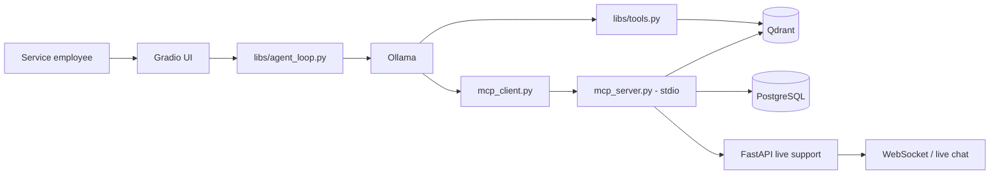

🌐 **Language:** [Türkçe](README.md) | English

## Anadolu Isuzu Technical Service Chatbot Assistant (Internship Project)

A technical assistant for Anadolu Isuzu employees, built on a locally hosted LLM with RAG and tool-calling. The system works on synthetic data consisting of maintenance manuals, parts catalogs, warranty records, and maintenance plans. If the user is not satisfied with an answer, they can start a live chat with technical service staff over WebSocket.

> **Important:** All data in this repository is synthetic. Warranty, stock, work order, and technical maintenance results must not be used in real service operations.


## Table of Contents

- [Architecture](#architecture)
- [File Tree](#file-tree)
- [Requirements](#requirements)
- [Installation](#installation)
- [Configuration](#configuration)
- [Quick Start](#quick-start)
- [Usage Examples](#usage-examples)
- [MCP Tools](#mcp-tools)
- [Live Support API](#live-support-api)
- [Data and Indexing](#data-and-indexing)
- [Known Limitations](#known-limitations)

## Architecture



Main flow:

1. The user's message is received from the Gradio interface in `main.py`.
2. `libs/agent_loop.py` passes the system instructions and tool schemas to the Qwen model.
3. Document questions are answered with `hybrid_query`, using dense + sparse search in Qdrant.
4. Warranty, part, error code, work order, and live support operations are executed through MCP tools.
5. When escalating to live support, FastAPI opens a session and a WebSocket-based chat area is added to the Gradio interface.

## File Tree

```text
.
├── main.py                                         Starts the Gradio chat interface.
├── mcp_client.py                                   Connects to the MCP server over stdio.
├── mcp_server.py                                   Exposes the MCP tools available to the assistant.
├── data/                                           Synthetic source data for vehicle models.
│   ├── .../
│   ├── TURKUAZ/                                    Sample data folder for the TURKUAZ model.
│   │   ├── TURKUAZ_BAKIM_PLANI.json                Maintenance mileages and operations.
│   │   ├── TURKUAZ_GARANTI_KAYITLARI.json          Chassis and warranty records.
│   │   ├── TURKUAZ_PARCA_KATALOGU.json             Part codes, prices, and stock information.
│   │   └── TURKUAZ_SERVIS_KILAVUZU.md              Service and troubleshooting information.
│   └── .../
├── libs/                                           Agent and search helper modules.
│   ├── agent_loop.py                               Manages the Ollama agent and the tool-call flow.
│   ├── file_path_finder.py                         Finds file paths in the data folders.
│   └── tools.py                                    Embedding and Qdrant hybrid search functions.
├── live_chat/                                      FastAPI live support server and UI.
│   ├── chat.js                                     Handles browser chat and WebSocket messaging.
│   ├── fastapi_server.py                           Provides live support API endpoints and the WebSocket.
│   ├── live_chat.css                               Styles for the live chat interface.
│   └── live_chat.html                              Live chat page served to the browser.
├── scripts/                                        Data conversion, preparation, and indexing scripts.
│   ├── error_code_scripts/                         Scripts that extract error codes and load them into PostgreSQL.
│   │   ├── parse_manuals.py                        Parses error codes from Markdown manuals.
│   │   └── send_to_server.py                       Writes error code records to PostgreSQL.
│   ├── pdf_extraction_scripts/                     Converts PDF manuals to Markdown and sample data.
│   │   ├── extract_manuals.py                      Batch-converts PDFs with Docling.
│   │   ├── extract_manuals_pymupdf.py              Batch-converts PDFs with PyMuPDF4LLM.
│   │   ├── extract_single_pdf.py                   Converts a single PDF file to Markdown.
│   │   └── fill_data.py                            Generates synthetic maintenance, warranty, and parts data per model.
│   └── qdrant_scripts/                             Qdrant search and data loading scripts.
│       ├── basic_query_test.py                     Quickly tests Qdrant queries.
│       ├── qdrant_send_jsons.py                    Uploads JSON data to Qdrant with embeddings.
│       └── qdrant_send_mds.py                      Chunks Markdown manuals and uploads them to Qdrant.
├── qdrant_storage/                                 Persistent storage for local Qdrant data.
├── devenv.nix                                      System packages, Python environment, and service definitions.
├── devenv.yaml                                     devenv project configuration.
├── postgres_tables.sql                             Schema definitions for the PostgreSQL tables.
├── qdrant_collection_info.json                     Qdrant collection configuration.
├── README.md                                       Turkish documentation.
└── README.en.md                                    Installation, usage, and architecture documentation (English).
```

## Requirements

The runtime environment and dependencies are defined in [devenv.nix](devenv.nix). The Python version, virtual environment, system packages, CUDA-enabled PyTorch index, environment variables, PostgreSQL service, and Qdrant process are all managed from this file.

### devenv.nix system packages

- Ollama (CUDA-accelerated package)
- `tesseract`
- `libpq`

### Python packages

The following Python packages are listed under `languages.python.venv.requirements` in `devenv.nix`:

- `torch`
- `torchvision`
- `torchaudio`
- `mcp`
- `ollama`
- `gradio`
- `fastapi`
- `fastapi-cli`
- `uvicorn`
- `qdrant-client`
- `pymupdf`
- `pymupdf4llm`
- `docling`
- `openai`
- `python-dotenv`
- `fastembed`
- `FlagEmbedding`
- `markdown_chunker`
- `chonkie`
- `psycopg[binary,pool]`
- `requests`

The CUDA 12.1 package index for PyTorch is defined separately in `devenv.nix`. Compatible NVIDIA drivers must be installed on the system to use CUDA.

Recommended models:

```text
qwen3.5:9b
nomic-embed-text-v2-moe
```

## Installation

### PostgreSQL Tables and Qdrant Collection Info

`postgres_tables.sql` contains the queries needed to create the required tables. You can use them to create the tables on your server.
`qdrant_collection_info.json` contains information about the Qdrant collection. You can use this file to create the collection on your Qdrant server.

### With devenv

`devenv.nix` contains the Python environment, the required system packages, and optional local PostgreSQL/Qdrant process definitions.

```bash
devenv shell
```

On the machine where Ollama will run, download the required models:

```bash
ollama serve
ollama pull qwen3.5:9b
ollama pull nomic-embed-text-v2-moe
```

If the Ollama server and models run on a different machine, perform these steps on that machine and write the remote Ollama address into the application's `.env` file. If Ollama is not installed, having only the `ollama` Python package on the application machine is not enough; an accessible Ollama server is required.

### Manual Python environment

If you are not using `devenv`, create a Python 3.12 virtual environment and install the packages listed in `venv.requirements` in `devenv.nix`. On machines that use CUDA, choose a PyTorch version compatible with your system's CUDA version.

## Configuration

Create a `.env` file in the project root and fill in the following keys with the URLs, database, and model details of your own environment. The values below are examples only; use your own service addresses and, if required, access keys.

```dotenv
OLLAMA_HOST=<your Ollama service URL>
QDRANT_ENV_KEY=<your Qdrant access key>
QDRANT_URL=<your Qdrant service URL>
QDRANT_COLLECTION_NAME=car_data
DENSE_EMBEDDING_MODEL=nomic-embed-text-v2-moe
DATA_PATH=data
POSTGRES_DATABASE_NAME=<your PostgreSQL database name>
POSTGRES_HOST=<your PostgreSQL host>
POSTGRES_PORT=<your PostgreSQL port>
POSTGRES_URL=<your PostgreSQL connection URL>
FASTAPI_URL=<your FastAPI service URL>
```

`OLLAMA_HOST` is the connection address of the Ollama client that is explicitly created in the code. For a local Ollama, use `http://localhost:11434`; for a remote Ollama, use the URL of that server. Although the code has default values for some settings, it is recommended to provide all connection details through `.env` to keep the setup portable and explicit.

Do not change the key names. In particular, the collection name must be written as `QDRANT_COLLECTION_NAME`; a one-letter typo such as `QDRANDT_COLLECTION_NAME` will not be read by the code. Do not commit the `.env` file to Git and do not share your access keys.

## Quick Start

This project does not require the dependent services to run on the same computer. PostgreSQL, Qdrant, and Ollama can run on other servers; which services the application connects to is determined by the URL, host, and port values in the `.env` file.

#### Main application with the Gradio interface:

```bash
python main.py
```

#### If you will run the live support FastAPI server on this application machine, in a separate terminal:

```bash
uvicorn live_chat.fastapi_server:app --reload
```

#### If the Ollama server will run on the same machine, in a separate terminal:

```bash
OLLAMA_CONTEXT_LENGTH=32000 ollama serve
```

**RECOMMENDATION:** For the LLM to produce the desired answers, set the context length to 32k tokens or more.

#### If the MCP server will run on the same machine, in a separate terminal:

```bash
python mcp_server.py
```

#### Local PostgreSQL and Qdrant

To run PostgreSQL locally, use your own PostgreSQL installation. For Qdrant, the following Podman command is given as an example:

```bash
podman run --rm \
	-p 6333:6333 -p 6334:6334 \
	--ulimit nofile=10000:10000 \
	-v "$(pwd)/qdrant_storage:/qdrant/storage" \
	docker.io/qdrant/qdrant
```

Qdrant data is stored persistently under `qdrant_storage/`. If the collection and vectors do not exist yet, complete the [data and indexing](#data-and-indexing) steps first.

## Usage Examples

Example requests the assistant can answer (the assistant is Turkish-language, so the prompts are shown in Turkish with English translations):

- `Bu şasi numaralı aracın garanti durumu nedir?` — What is the warranty status of the vehicle with this chassis number?
- `180000 km bakımında hangi işlemler yapılmalı?` — Which operations should be performed at the 180,000 km service?
- `Bu parça kodunun stok durumu nedir?` — What is the stock status of this part code?
- `CITIVOLT modelinde P0420 hata kodu ne anlama gelir?` — What does error code P0420 mean on the CITIVOLT model?
- `Bu araç için iş emri oluştur: fren sistemi kontrolü` — Create a work order for this vehicle: brake system check.
- `Yanıt yeterli olmadı, teknik elemana aktarır mısın?` — The answer was not sufficient, can you transfer me to a technician?

If a model name is specified, a filter is applied in the hybrid search. Supported model names are the folder names under `data/`: `BIG-E`, `CITIBUS`, `CITIPORT`, `CITIVOLT`, `D-MAX`, `ELF-2600`, `GRAND_NOVO`, `GRAND_NOVOULTRA`, `GRAND_TORO`, `INTERLINER`, `KENDO`, `NOVO_NOVOLUX`, `NOVOCITI_LIFE`, `NOVOCITI_VOLT`, `TURKUAZ`, and `VISIGO`.

## MCP Tools

`mcp_server.py` starts the MCP server over stdio. `mcp_client.py` connects to this server and converts MCP results into Ollama's tool-calling format.

| Tool | Purpose | Data source |
|---|---|---|
| `get_warranty_status(sasi_no)` | Returns the warranty record for a chassis number | Qdrant metadata |
| `check_part_stock(parca_kodu)` | Returns the part record and stock information | Qdrant metadata |
| `get_error_code_info(errcode, arac_modeli)` | Returns the description of an error code | PostgreSQL |
| `create_work_order(sasi_no, aciklama)` | Creates a work order | PostgreSQL |
| `escalate_live_chat(chat_summary)` | Transfers the user to a suitable technician | FastAPI + PostgreSQL |

To test the MCP server directly:

```bash
python mcp_server.py
```

Since this process waits for stdio, it is not a regular HTTP server; tool calls must be made through `mcp_client.py` inside the application.

## Live Support API

The FastAPI server provides the following endpoints:

| Method | Endpoint | Description |
|---|---|---|
| `POST` | `/escalate` | Selects an available technician and opens a session |
| `POST` | `/sessions/{session_id}/messages` | Saves a message to the session and broadcasts it |
| `GET` | `/sessions/{session_id}/messages` | Returns the session history |
| `POST` | `/sessions/{session_id}/close` | Closes the session and makes the staff member available again |
| `WS` | `/ws/{session_id}` | Real-time messaging connection |
| `GET` | `/live-chat-ui` | Serves the live chat HTML interface |

Live support requires at least the `technical_staff`, `chat_sessions`, and `chat_messages` tables in PostgreSQL. The work order and error code tools additionally require the `work_orders` and `error_codes` tables, respectively. If schema/migration files are not defined separately in this repository, you need to create the tables according to your environment.

## Data and Indexing

### Source data

Each vehicle model contains the following files under `data/<MODEL>/`:

- `<MODEL>_BAKIM_PLANI.json` (maintenance plan)
- `<MODEL>_GARANTI_KAYITLARI.json` (warranty records)
- `<MODEL>_PARCA_KATALOGU.json` (parts catalog)
- `<MODEL>_SERVIS_KILAVUZU.md` (service manual)

### Qdrant index

The scripts in `qdrant_scripts/` chunk the JSON and Markdown data, generate embeddings, and upload them to the `car_data` collection. For Markdown service manuals, the `window_context` field is used to preserve the context of neighboring chunks.

Before uploading new data:

1. Check that Qdrant is running.
2. Check that the Ollama embedding model is available.
3. Verify the `DATA_PATH` and collection settings of the scripts.
4. After uploading, run sample queries to check the model filter and the number of results.

### PDF extraction and error codes

The scripts in `scripts/pdf_extraction_scripts/` convert service manual PDFs to Markdown:

- `extract_manuals.py` batch-processes the PDFs in a directory using Docling; it preserves document structure and tables and produces a `_SERVIS_KILAVUZU.md` output for each PDF.
- `extract_manuals_pymupdf.py` does the same batch conversion with PyMuPDF4LLM.
- `extract_single_pdf.py` converts a single PDF file with Docling.
- `fill_data.py` generates sample/synthetic vehicle data; it creates the maintenance plan, warranty, parts catalog, and Markdown service manual files per model.

The `scripts/error_code_scripts/` directory contains the flow for loading error codes from service manuals into PostgreSQL:

- `parse_manuals.py` scans the Markdown files under `DATA_PATH`; it extracts the error code from headings, the vehicle model from the file path, and the description from the following text.
- `send_to_server.py` inserts the extracted error code/model/description records into the `error_codes` table in PostgreSQL. Before running it, verify the `.env` connection settings and the table schema.

## Known Limitations

- The data is synthetic and is not a reliable source for real service decisions.
- This repository has no automatic migration flow for PostgreSQL tables.
- `create_work_order` and the live support endpoints write to the database; use them in a test environment.
- Because MCP tools start a stdio process on every call, they are not suitable for high-traffic use.
- The agent's step limit is 40; complex tool chains may exceed this limit.
- If Qdrant and Ollama are not running, RAG and embedding-based queries fail.
- `logs.txt` is cleared on every Gradio startup; a separate logging system should be added for persistent logging.
